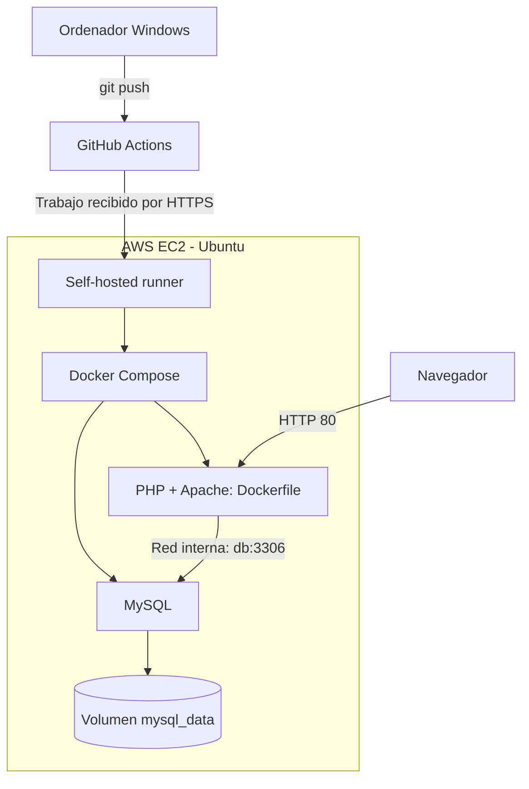

# Práctica guiada: CI/CD de PHP y MySQL en AWS EC2

**Ciclo:** DAW / ASIR · **Duración orientativa:** 3–4 horas · **Modalidad:** individual

## 1. Reto y objetivos

Una empresa quiere publicar automáticamente una aplicación PHP con MySQL cada vez que se actualice la rama `main` de su repositorio. Vamos a configurar un servidor EC2 que ejecute los trabajos de GitHub Actions directamente mediante un *self-hosted runner* (ejecutor autohospedado).

Al finalizar serás capaz de crear una instancia EC2, construir una imagen propia mediante un Dockerfile, orquestar dos servicios con Compose, utilizar secretos y demostrar que los datos sobreviven a un nuevo despliegue.



**¿Por qué un runner autohospedado?** El ejecutor se instala en EC2 y establece una conexión saliente con GitHub. Cuando hay un `push`, recibe el trabajo, descarga el código y ejecuta Docker en la propia máquina. No hay que configurar claves SSH adicionales, IAM, OIDC ni transferencias SCP. La clave `.pem` se usa exclusivamente para administrar EC2 desde Windows.

> [!WARNING]
> Utiliza un repositorio **privado**, una EC2 dedicada a esta práctica y únicamente colaboradores de confianza. Un runner con acceso al grupo `docker` dispone de privilegios equivalentes a root. No ejecutes código no confiable ni workflows de pull requests. La web de ejemplo no dispone de autenticación ni HTTPS: utiliza datos ficticios y limita HTTP a tu IP. No es una arquitectura de producción.

## 2. Material y estructura del repositorio

Necesitas una cuenta AWS con autorización para crear instancias y grupos de seguridad, una cuenta GitHub, Git y OpenSSH en Windows, conexión a Internet y un editor (por ejemplo VS Code). No necesitas Docker Desktop en Windows: Docker se ejecutará en EC2.

```text
.
├── .github/workflows/despliegue.yml
├── src/index.php
├── mysql/init/01-init.sql
├── Dockerfile
├── compose.yaml
├── .dockerignore
├── .gitignore
└── README.md
```

- `Dockerfile`: instrucciones para construir la imagen PHP.
- `compose.yaml`: define servicios, red, variables, puertos y volumen.
- `src/index.php`: formulario que guarda y consulta registros mediante PDO.
- `mysql/init/01-init.sql`: crea la tabla al inicializar MySQL.
- `.github/workflows/despliegue.yml`: automatiza el despliegue.
- `.gitignore`: evita incorporar claves y archivos de configuración privados; no sustituye la revisión de archivos antes de subirlos.
- `.dockerignore`: limita el contexto de construcción a los archivos PHP y al Dockerfile.

**Convención:** los bloques `powershell` se ejecutan en Windows; los bloques `bash` se ejecutan en Ubuntu, después de entrar por SSH. Los bloques YAML, PHP y SQL corresponden a archivos del proyecto.

## 3. Crear el repositorio privado en GitHub

1. Accede a GitHub → **New repository**.
2. Indica un nombre, por ejemplo `practica-cicd-ec2`.
3. Selecciona **Private**. No marques la creación de README, licencia ni `.gitignore`, porque ya están incluidos en el material.
4. Pulsa **Create repository**.
5. Descarga y descomprime el ZIP del ejercicio en Windows. Abre la carpeta que contiene directamente el `README.md` con VS Code. Comprueba que `.github` está incluida.

**Importante:** todavía no hagas el primer `push`. Primero prepararemos el servidor, el runner y los secretos. Así evitamos que el workflow quede esperando un ejecutor que aún no existe.

En una terminal PowerShell de VS Code, desde la carpeta del proyecto:

```powershell
git --version
Get-ChildItem -Force
```

Si Git no está instalado, descárgalo desde https://git-scm.com/download/win. Si es necesario, configura tu identidad:

```powershell
git config --global user.name "TU NOMBRE"
git config --global user.email "TU CORREO DE GITHUB"
```

## 4. Crear la instancia EC2

En la consola de AWS, abre **EC2 → Instances → Launch instances**. Selecciona una región permitida en tu cuenta (anótala para localizar después la instancia).

| Campo | Valor recomendado |
|---|---|
| Name | `daw-cicd` |
| AMI | Ubuntu Server 24.04 LTS, 64 bits x86 |
| Instance type | `t3.small` (2 GiB RAM), si está permitido |
| Key pair | Crear o seleccionar `clase-ec2` (formato `.pem`) |
| Network | VPC y subred pública con salida a Internet |
| Auto-assign public IP | Enable |
| Storage | 20 GiB gp3, orientativo |

La instancia será el servidor que ejecutará PHP, MySQL, Docker y el runner. La memoria y el disco propuestos dan margen para construir imágenes y alojar MySQL. El tipo de instancia y almacenamiento pueden generar costes; no presupongas que son gratuitos. Si el laboratorio restringe el tipo, consulta al profesor.

En **Network settings**, crea un grupo de seguridad con las siguientes reglas de entrada:

| Tipo | Puerto | Origen |
|---|---|---|
| SSH | TCP 22 | My IP (Mi IP) |
| HTTP | TCP 80 | My IP (Mi IP) |

El puerto 22 permite administrar Ubuntu; el 80 permite acceder a Apache desde tu navegador. No abras el puerto 3306: PHP se comunica con MySQL por la red interna de Docker. El runner necesita salida a Internet mediante HTTPS (443); conserva la salida predeterminada del grupo de seguridad durante la práctica.

Pulsa **Launch instance**, espera a que el estado sea `Running` y a que se superen las comprobaciones de estado. Copia la dirección IPv4 pública. No utilices la IP privada desde Windows.

> La IP pública puede cambiar si detienes y arrancas la instancia. Si cambia, utiliza la nueva IP para SSH y HTTP. El runner no necesita que configures esa IP en GitHub.

## 5. Preparar la clave privada y conectarse desde Windows

Guarda la clave `.pem` descargada en `C:\docker\clase-ec2.pem` (fuera del repositorio). Si Windows muestra `UNPROTECTED PRIVATE KEY FILE`, abre PowerShell con tu usuario habitual; eleva permisos con ese mismo usuario si es necesario.

```powershell
$clave = "C:\docker\clase-ec2.pem"
$usuario = whoami
icacls $clave /reset
icacls $clave /setowner "$usuario"
icacls $clave /grant:r "${usuario}:(R)"
icacls $clave /inheritance:r
icacls $clave
```

`/reset` restablece permisos; `/setowner` establece el propietario; `/grant:r` concede lectura explícita; `/inheritance:r` elimina los permisos heredados. Comprueba que solo tu usuario tiene acceso. Si hay otras entradas explícitas, revísalas desde Propiedades → Seguridad → Opciones avanzadas. Utiliza NTFS: FAT32/exFAT no admiten estas ACL.

Conéctate sustituyendo `IP_PUBLICA` por la dirección de tu instancia:

```powershell
ssh -i "C:\docker\clase-ec2.pem" ubuntu@IP_PUBLICA
```

`-i` indica la clave privada y `ubuntu` es el usuario habitual de la AMI oficial Ubuntu. En la primera conexión, compara la huella SSH presentada con la obtenida por un canal fiable (por ejemplo, el registro del sistema de EC2 si contiene esa huella) antes de aceptar. No aceptes una huella que no puedas verificar.

Una vez conectado, la terminal mostrará `ubuntu@ip-...`. Los siguientes comandos ya se ejecutan en EC2:

```bash
whoami
hostname
cat /etc/os-release
uname -m
```

El usuario esperado es `ubuntu` y la arquitectura `x86_64`. No cierres todavía la sesión.

## 6. Instalar Docker Engine y Docker Compose en Ubuntu

Docker Engine ejecuta los contenedores. Docker Compose permite definir y administrar varios contenedores relacionados mediante un archivo YAML. Instalaremos el plugin oficial, que se invoca como `docker compose` (sin guion).

### 6.1. Preparar el repositorio de Docker

```bash
sudo apt update
sudo apt install -y ca-certificates curl git
sudo install -m 0755 -d /etc/apt/keyrings
sudo curl -fsSL https://download.docker.com/linux/ubuntu/gpg -o /etc/apt/keyrings/docker.asc
sudo chmod a+r /etc/apt/keyrings/docker.asc
```

`apt update` actualiza el índice de paquetes; `curl` permite descargar archivos y la clave GPG permite verificar la autenticidad de los paquetes del repositorio oficial.

```bash
. /etc/os-release
CODENAME="${UBUNTU_CODENAME:-$VERSION_CODENAME}"
ARCH="$(dpkg --print-architecture)"
printf 'deb [arch=%s signed-by=/etc/apt/keyrings/docker.asc] https://download.docker.com/linux/ubuntu %s stable\n' "$ARCH" "$CODENAME" | sudo tee /etc/apt/sources.list.d/docker.list > /dev/null
sudo apt update
```

Se añade el repositorio adecuado a la versión y arquitectura de Ubuntu. El comando `tee` escribe la configuración con permisos administrativos.

### 6.2. Instalar y activar Docker

```bash
sudo apt install -y docker-ce docker-ce-cli containerd.io docker-buildx-plugin docker-compose-plugin
sudo systemctl enable --now docker
sudo usermod -aG docker ubuntu
```

- `docker-ce` y `docker-ce-cli`: motor y cliente de Docker.
- `containerd.io`: entorno de ejecución de contenedores.
- `docker-buildx-plugin`: construcción de imágenes.
- `docker-compose-plugin`: gestión de los servicios definidos en YAML.
- `systemctl enable --now`: inicia Docker y lo habilita al arrancar Ubuntu.
- `usermod -aG docker ubuntu`: permite al usuario del runner usar Docker sin `sudo`. Este grupo tiene privilegios elevados; no lo concedas a usuarios no confiables.

Cierra la sesión con `exit` y vuelve a conectarte desde Windows:

```powershell
ssh -i "C:\docker\clase-ec2.pem" ubuntu@IP_PUBLICA
```

La nueva sesión carga la pertenencia al grupo `docker`. Verifica en Ubuntu:

```bash
id
docker --version
docker compose version
docker run --rm hello-world
```

`hello-world` descarga una pequeña imagen, ejecuta un contenedor y comprueba que el motor funciona sin `sudo`. `--rm` elimina ese contenedor al terminar. Si falla por permisos, comprueba `id` y que has vuelto a iniciar sesión.

## 7. Instalar el self-hosted runner en EC2

Un runner es el proceso que recibe y ejecuta trabajos de GitHub Actions. En lugar de usar una máquina temporal de GitHub, haremos que los comandos se ejecuten directamente en EC2.

### 7.1. Obtener las instrucciones de registro

En tu repositorio privado de GitHub, abre **Settings → Actions → Runners → New self-hosted runner**.

Selecciona **Linux** y **x64**. GitHub muestra comandos de descarga, comprobación de integridad, extracción y configuración. Copia los que aparecen en tu repositorio: incluyen la versión vigente y un token de registro temporal específico. No copies tokens en el README, en commits ni en capturas.

### 7.2. Descargar y registrar el runner

En la terminal Ubuntu, con el usuario `ubuntu` (no root), ejecuta en orden los comandos de la sección **Download** que muestra GitHub. Habitualmente comienzan así:

```bash
mkdir -p ~/actions-runner
cd ~/actions-runner
```

Después ejecuta los comandos `curl`, verificación de SHA256 y `tar` que GitHub proporciona. No uses versiones o URLs inventadas: la página las genera. Si el configurador informa de dependencias ausentes, sigue su indicación (puede requerir `sudo ./bin/installdependencies.sh`).

Ejecuta el comando `./config.sh --url ... --token ...` de la sección **Configure**. Responde a las preguntas:

| Pregunta | Respuesta |
|---|---|
| Runner group (si aparece) | Intro, grupo predeterminado |
| Runner name | `ec2-daw` |
| Additional labels | `ec2-daw` |
| Work folder | Intro, `_work` |

El nombre identifica el runner en GitHub. La etiqueta adicional `ec2-daw` permite que el workflow seleccione específicamente este ejecutor. Si el token ha caducado, genera otro desde la página de GitHub.

### 7.3. Ejecutar como servicio

No es necesario mantener la terminal SSH abierta. Desde `~/actions-runner`:

```bash
sudo ./svc.sh install ubuntu
sudo ./svc.sh start
sudo ./svc.sh status
```

El primer comando instala un servicio de systemd ejecutado como `ubuntu`; el segundo lo inicia; el tercero muestra su estado. De esta forma el runner continúa funcionando después de cerrar SSH y al reiniciar EC2. No ejecutes también `./run.sh` a la vez.

En GitHub → Settings → Actions → Runners, verifica que aparece `ec2-daw` con estado **Idle** y las etiquetas `self-hosted`, `Linux`, `X64`, `ec2-daw`. Idle significa que está disponible para recibir trabajos. Busy significa que está ejecutando uno. Offline significa que no está conectado.

## 8. Comprender el Dockerfile

Abre `Dockerfile` en VS Code:

```dockerfile
FROM php:8.3-apache
RUN docker-php-ext-install pdo_mysql
COPY src/ /var/www/html/
EXPOSE 80
```

| Instrucción | Explicación |
|---|---|
| `FROM` | Imagen base con PHP y el servidor Apache ya instalado. |
| `RUN` | Instala la extensión PDO para conectarse a MySQL durante la construcción. |
| `COPY` | Incorpora el código PHP a la imagen en la carpeta pública de Apache. |
| `EXPOSE` | Documenta el puerto de escucha del contenedor; no publica el puerto por sí solo. |

La imagen es una plantilla; el contenedor es una instancia en ejecución de esa imagen. Cuando cambies `src/index.php` y ejecutes un nuevo build, el código se incorporará a una nueva imagen. No montamos el código PHP desde Windows: queremos probar el proceso real de construcción.

## 9. Comprender Docker Compose

Abre `compose.yaml`. Contiene dos servicios: `web` y `db`.

| Elemento | Para qué sirve |
|---|---|
| `name: practica-cicd` | Mantiene un nombre de proyecto estable entre despliegues. |
| `web.build` | Construye la imagen PHP con el Dockerfile situado en el directorio actual. |
| `db.image` | Descarga MySQL 8.4; no necesita Dockerfile propio. |
| `ports: ["80:80"]` | Publica el puerto 80 del contenedor web en el puerto 80 de EC2. |
| `environment` | Inyecta la configuración necesaria en los contenedores. |
| `DB_HOST: db` | Nombre del servicio MySQL, resuelto por DNS interno de Docker. |
| `depends_on` + `service_healthy` | Espera a que MySQL pueda consultar la tabla antes de arrancar la web. |
| `healthcheck` | Comprueba periódicamente que la base de datos y la web responden. |
| `restart: unless-stopped` | Reinicia los contenedores tras fallos o reinicios del servidor salvo parada explícita. |
| `mysql_data:/var/lib/mysql` | Almacena los datos fuera del sistema de archivos efímero del contenedor. |
| `./mysql/init:/docker-entrypoint-initdb.d:ro` | Monta los scripts SQL de inicialización en modo solo lectura. |

Compose crea una red interna automáticamente. `localhost` dentro de PHP sería el propio contenedor PHP, no MySQL; por eso se usa `db` como host. No se publica el puerto 3306 en EC2.

Las expresiones `${MYSQL_PASSWORD:?Falta MYSQL_PASSWORD}` exigen que la variable esté definida y no sea vacía. Compose sustituye el valor cuando procesa el YAML. En los healthchecks, `$$` evita que Compose sustituya la variable antes de que la interprete el shell del contenedor.

## 10. Comprender MySQL y la aplicación PHP

El archivo `mysql/init/01-init.sql` crea la tabla `mensajes`:

```sql
CREATE TABLE IF NOT EXISTS mensajes (
    id INT UNSIGNED AUTO_INCREMENT PRIMARY KEY,
    nombre VARCHAR(100) NOT NULL,
    creado TIMESTAMP DEFAULT CURRENT_TIMESTAMP
);
```

El servidor MySQL ejecuta los scripts de inicialización cuando su directorio de datos está vacío. En despliegues posteriores reutiliza el volumen y no vuelve a ejecutarlos. Cambiar el SQL de inicialización no modifica una base ya existente: para ello se necesitan migraciones.

Abre `src/index.php`. La aplicación lee las variables `DB_HOST`, `DB_NAME`, `DB_USER` y `DB_PASSWORD` mediante `getenv()`, crea una conexión PDO, procesa el formulario con una sentencia preparada `INSERT`, y consulta los registros con `SELECT`. El redireccionamiento tras guardar evita repetir el POST al refrescar. `htmlspecialchars` protege la salida HTML. Si MySQL no responde, la web devuelve HTTP 503, de modo que la prueba del despliegue detecta el fallo.

Localiza la variable `$version = '1.0';`: será la que modificarás en la segunda publicación.

## 11. Configurar los dos secretos de GitHub

En GitHub, abre **Settings → Secrets and variables → Actions → Secrets → New repository secret**. Crea cada uno por separado:

| Name | Secret |
|---|---|
| `MYSQL_ROOT_PASSWORD` | Contraseña fuerte y exclusiva para el administrador de MySQL. |
| `MYSQL_PASSWORD` | Otra contraseña fuerte para el usuario `alumno`. |

Genera contraseñas distintas (por ejemplo, con un gestor de contraseñas), de al menos 20 caracteres. No uses las palabras de ejemplo como contraseñas. No se necesita `EC2_SSH_KEY`, IP de EC2, token AWS ni usuario SSH en los secretos.

Los secretos son valores protegidos que GitHub entrega al workflow durante su ejecución. El código no contiene las contraseñas. No las imprimas ni ejecutes `docker compose config` sin `--quiet`, pues puede mostrar valores interpolados. Usuarios con acceso privilegiado al servidor o a Docker pueden recuperar variables de los contenedores: no equivale a una bóveda de producción.

Mantén las mismas contraseñas durante el ejercicio: cambiar los secretos de GitHub no cambia automáticamente las contraseñas de un MySQL ya inicializado. No borres el volumen para resolver ese problema.

## 12. Comprender GitHub Actions

El archivo `.github/workflows/despliegue.yml` ya está incluido. Ábrelo y estudia su contenido:

```yaml
name: Despliegue en EC2
on:
  push:
    branches: [main]
  workflow_dispatch:
permissions:
  contents: read
concurrency:
  group: despliegue-ec2
  cancel-in-progress: false
jobs:
  deploy:
    runs-on: [self-hosted, linux, x64, ec2-daw]
    timeout-minutes: 20
    env:
      MYSQL_ROOT_PASSWORD: ${{ secrets.MYSQL_ROOT_PASSWORD }}
      MYSQL_PASSWORD: ${{ secrets.MYSQL_PASSWORD }}
    steps:
      - name: Descargar codigo
        uses: actions/checkout@v6
        with:
          persist-credentials: false
      - name: Validar Docker Compose
        run: docker compose config --quiet
      - name: Construir y desplegar
        run: docker compose up -d --build --remove-orphans --wait --wait-timeout 180
      - name: Comprobar contenedores
        run: docker compose ps
      - name: Comprobar aplicacion HTTP
        run: curl --fail --silent --show-error http://127.0.0.1/ > /dev/null
```

| Bloque | Explicación |
|---|---|
| `name` | Nombre del workflow que aparecerá en Actions. |
| `on.push.branches` | Ejecuta la acción al realizar push a `main`. |
| `workflow_dispatch` | Permite iniciar manualmente el workflow desde GitHub. |
| `permissions: contents: read` | Limita el token automático de GitHub a la lectura del repositorio. |
| `concurrency` | Evita que dos despliegues de este workflow se ejecuten simultáneamente. Un push intermedio pendiente puede ser sustituido por otro más reciente. |
| `jobs.deploy` | Trabajo encargado de publicar la aplicación. |
| `runs-on` | Selecciona el runner Linux x64 con etiqueta `ec2-daw`. Todos los comandos siguientes se ejecutan en EC2. |
| `timeout-minutes` | Evita que un trabajo bloqueado se ejecute indefinidamente. |
| `env` | Entrega los dos secretos de MySQL como variables de entorno. |
| `actions/checkout@v6` | Descarga el commit correspondiente al trabajo en el directorio del runner; no hace falta clonar manualmente en EC2. Requiere runner actualizado. |
| `persist-credentials: false` | Evita dejar configuradas las credenciales del checkout para posteriores comandos Git. |
| `docker compose config --quiet` | Valida el YAML y las variables sin mostrar su contenido. |
| `docker compose up` | Crea o actualiza los servicios. |
| `-d` | Ejecuta los contenedores en segundo plano. |
| `--build` | Reconstruye la imagen PHP utilizando el Dockerfile. |
| `--remove-orphans` | Elimina contenedores del mismo proyecto que ya no están definidos. |
| `--wait --wait-timeout 180` | Espera a que los servicios estén listos (hasta 180 segundos en esta fase). |
| `docker compose ps` | Muestra el estado de los contenedores. |
| `curl --fail ...` | Comprueba que la página devuelve una respuesta HTTP correcta desde EC2. |

No se realiza una conexión SSH desde GitHub: el runner ya está dentro del servidor. Tampoco se utiliza `docker compose down` antes de desplegar. Compose recrea lo necesario y conserva el volumen. Este flujo sencillo puede causar una breve interrupción del servicio y no implementa rollback automático.

## 13. Primer push y primer despliegue

Desde Windows, abre PowerShell en la carpeta del proyecto. Antes de subir, revisa que no hay claves ni contraseñas:

```powershell
git init
git branch -M main
git add .
git status
git diff --cached --stat
git commit -m "Primer despliegue PHP y MySQL"
git remote add origin https://github.com/TU_USUARIO/practica-cicd-ec2.git
git push -u origin main
```

Sustituye `TU_USUARIO` y el nombre del repositorio por los tuyos. Si Git solicita autenticación, utiliza el inicio de sesión de Git Credential Manager o el método autorizado por tu centro. Si ya tenías un repositorio Git inicializado, no repitas `git remote add origin`; revisa `git remote -v`.

`git add` prepara los archivos, `commit` crea una versión local, `remote add` asocia el repositorio remoto y `push` publica la versión. El push a `main` activa el workflow.

En GitHub → **Actions → Despliegue en EC2**, abre la ejecución y observa cada paso. El primer despliegue puede tardar más porque Docker descarga las imágenes y construye PHP. Si todo funciona, todos los pasos aparecen en verde.

En el navegador de Windows, visita `http://IP_PUBLICA` (sustituye la IP). Debes ver el título «Aplicación PHP - versión 1.0», la conexión a MySQL y un formulario. Si el navegador intenta HTTPS, indica explícitamente `http://`.

## 14. Comprobar los contenedores en EC2

Conéctate por SSH y ejecuta en Ubuntu:

```bash
docker ps
docker volume ls
docker network ls
curl --fail http://127.0.0.1/ -o /dev/null
```

Espera dos contenedores (`practica-cicd-web-1` y `practica-cicd-db-1`, salvo variaciones de nombre), ambos sanos. El volumen esperado es `practica-cicd_mysql_data`; la red es `practica-cicd_default`. El puerto publicado es el 80 del servicio web.

Puedes examinar el estado sin conocer las contraseñas con `docker ps` y `docker logs practica-cicd-web-1`. Para comandos Compose fuera del workflow necesitarías proporcionar de nuevo las variables de entorno requeridas; no guardes los secretos dentro del directorio `_work` del runner.

## 15. Segundo despliegue: verificar persistencia

1. Introduce dos nombres ficticios desde la web, por ejemplo `Prueba A` y `Prueba B`. Comprueba que aparecen en la tabla y anota sus IDs.
2. En Windows, modifica `src/index.php`: sustituye `$version = '1.0';` por `$version = '2.0';`. Añade también un texto nuevo en la página.
3. Guarda los cambios y realiza un nuevo push:

```powershell
git add src/index.php
git commit -m "Publicar version 2.0"
git push
```

4. Abre Actions y comprueba que se inicia una ejecución diferente, asociada a tu nuevo commit, y termina correctamente.
5. Recarga la web (Ctrl+F5 si es necesario). Debe mostrar la versión 2.0 y los mismos registros con los mismos IDs.
6. En EC2, ejecuta `docker volume ls` y confirma que se mantiene el volumen.

**Pregunta:** ¿por qué no desaparecen los registros aunque se reconstruya la imagen PHP? Porque se guardan en el volumen de MySQL, independiente del contenedor web. Tampoco se elimina el volumen al recrear el contenedor MySQL.

> [!WARNING]
> No ejecutes `docker compose down -v`, `docker volume rm` ni `docker system prune --volumes` durante la prueba de persistencia. Podrías perder los datos.

## 16. Resolución de problemas

| Síntoma | Comprobación y solución |
|---|---|
| SSH: `bad permissions` | Revisa `icacls` y el propietario de la clave; utiliza NTFS. |
| SSH: `Connection timed out` | Comprueba estado de EC2, IP pública, grupo de seguridad y subred pública. |
| Job en `Queued` | Revisa que el runner está Idle, que tiene etiqueta `ec2-daw` y que Actions está habilitado. |
| Runner Offline | En `~/actions-runner`: `sudo ./svc.sh status` y, si está parado, `sudo ./svc.sh start`. Revisa salida HTTPS. |
| Docker: `permission denied` | Verifica `id` y grupo `docker`; reinicia el servicio del runner después de corregir los permisos. |
| Error de variables obligatorias | Comprueba los nombres exactos de los dos secretos y que no están vacíos. |
| MySQL no saludable | Consulta `docker logs practica-cicd-db-1`. Comprueba memoria, disco y contraseñas originales. No elimines datos. |
| Puerto 80 ocupado | Ejecuta `sudo ss -ltnp` y revisa qué servicio lo utiliza. No detengas servicios ajenos a la práctica. |
| Web inaccesible, pero Actions verde | Comprueba el grupo de seguridad HTTP desde tu IP actual y la nueva IP pública si ha cambiado. |
| Web no actualizada | Revisa commit, rama `main`, paso de build y recarga del navegador. |
| Falta espacio o memoria | Ejecuta `df -h`, `free -h`, `docker system df`; consulta antes de borrar recursos. |

Para revisar el runner, desde Ubuntu:

```bash
cd ~/actions-runner
sudo ./svc.sh status
```

Para consultar logs de contenedores:

```bash
docker ps -a
docker logs --tail 50 practica-cicd-web-1
docker logs --tail 50 practica-cicd-db-1
```


