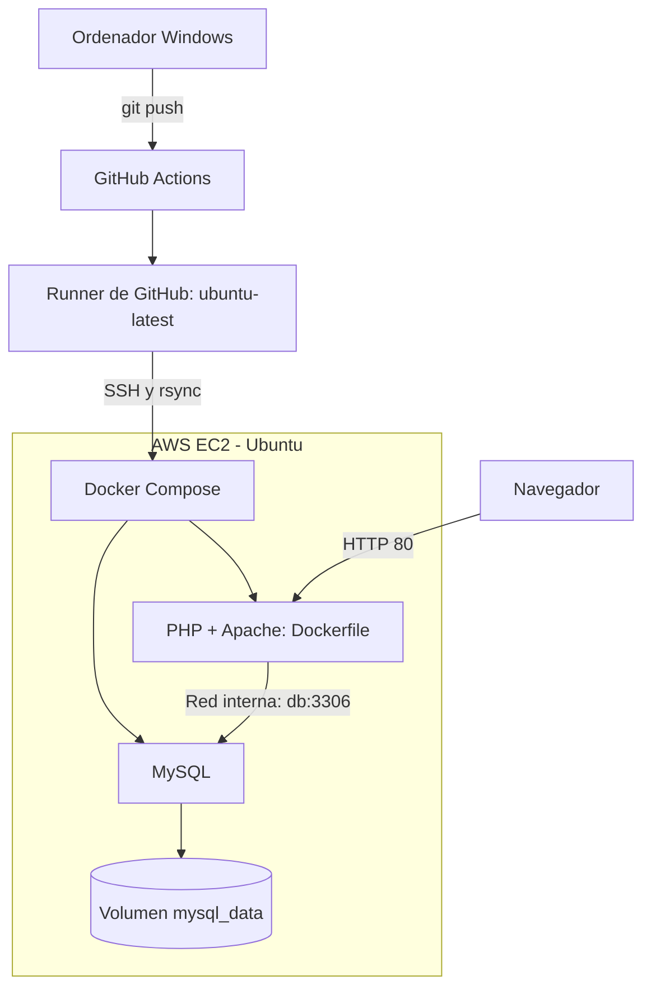

# Práctica guiada: CI/CD de PHP y MySQL en AWS EC2

**Ciclo:** DAW / ASIR · **Duración orientativa:** 3–4 horas · **Modalidad:** individual

## 1. Reto y objetivos

Una empresa quiere publicar automáticamente una aplicación PHP con MySQL cada vez que se actualice la rama `main` de su repositorio. Vamos a configurar un servidor EC2 al que GitHub Actions se conectará mediante SSH desde su máquina temporal (`ubuntu-latest`).

Al finalizar serás capaz de crear una instancia EC2, construir una imagen propia mediante un Dockerfile, orquestar dos servicios con Compose, utilizar secretos y demostrar que los datos sobreviven a un nuevo despliegue.



**¿Dónde se ejecuta cada cosa?** GitHub proporciona una máquina Linux temporal para ejecutar el workflow. Esta descarga el código, lo copia por SSH a EC2 y ordena a Docker Compose que lo despliegue allí. No se instala ningún runner en EC2 ni se crean usuarios, claves adicionales o roles IAM. Reutilizaremos el usuario `ubuntu` y la clave `.pem` original.

> [!WARNING]
> Utiliza un repositorio privado y una EC2 dedicada y desechable, sin datos reales ni credenciales AWS adicionales. El usuario `ubuntu` tiene privilegios elevados; cualquier workflow autorizado con la clave puede administrar el servidor. No ejecutes código de terceros no confiable. HTTP no está cifrado. Restringe el acceso a tu IP y elimina los secretos al terminar.

## 2. Material y estructura del repositorio

Necesitas una cuenta AWS con autorización para crear instancias y grupos de seguridad, una cuenta GitHub, Git y OpenSSH en Windows, conexión a Internet y un editor (por ejemplo VS Code). No necesitas Docker Desktop en Windows: Docker se ejecutará en EC2.

```text
.
├── .github/workflows/despliegue.yml
├── src/index.php
├── mysql/init/01-init.sql
├── Dockerfile
├── compose.yaml
├── .dockerignore
├── .gitignore
└── README.md
```

- `Dockerfile`: instrucciones para construir la imagen PHP.
- `compose.yaml`: define servicios, red, variables, puertos y volumen.
- `src/index.php`: formulario que guarda y consulta registros mediante PDO.
- `mysql/init/01-init.sql`: crea la tabla al inicializar MySQL.
- `.github/workflows/despliegue.yml`: automatiza el despliegue.
- `.gitignore`: evita incorporar claves y archivos de configuración privados; no sustituye la revisión de archivos antes de subirlos.
- `.dockerignore`: limita el contexto de construcción a los archivos PHP y al Dockerfile.

**Convención:** los bloques `powershell` se ejecutan en Windows; los bloques `bash` se ejecutan en Ubuntu, después de entrar por SSH. Los bloques YAML, PHP y SQL corresponden a archivos del proyecto.

## 3. Crear el repositorio privado en GitHub

1. Accede a GitHub → **New repository**.
2. Indica un nombre, por ejemplo `practica-cicd-ec2`.
3. Selecciona **Private**. No marques la creación de README, licencia ni `.gitignore`, porque ya están incluidos en el material.
4. Pulsa **Create repository**.
5. Descarga y descomprime el ZIP del ejercicio en Windows. Abre la carpeta que contiene directamente el `README.md` con VS Code. Comprueba que `.github` está incluida.

**Importante:** todavía no hagas el primer `push`. Primero prepararemos el servidor, el acceso SSH y los secretos. Así evitamos un primer despliegue fallido.

En una terminal PowerShell de VS Code, desde la carpeta del proyecto:

```powershell
git --version
Get-ChildItem -Force
```

Si Git no está instalado, descárgalo desde https://git-scm.com/download/win. Si es necesario, configura tu identidad:

```powershell
git config --global user.name "TU NOMBRE"
git config --global user.email "TU CORREO DE GITHUB"
```

## 4. Crear la instancia EC2

En la consola de AWS, abre **EC2 → Instances → Launch instances**. Selecciona una región permitida en tu cuenta (anótala para localizar después la instancia).

| Campo | Valor recomendado |
|---|---|
| Name | `daw-cicd` |
| AMI | Ubuntu Server 24.04 LTS, 64 bits x86 |
| Instance type | `t3.small` (2 GiB RAM), si está permitido |
| Key pair | Crear o seleccionar `clase-ec2` (formato `.pem`) |
| Network | VPC y subred pública con salida a Internet |
| Auto-assign public IP | Enable |
| Storage | 20 GiB gp3, orientativo |

La instancia será el servidor que ejecutará PHP, MySQL y Docker. La memoria y el disco propuestos dan margen para construir imágenes y alojar MySQL. El tipo de instancia y almacenamiento pueden generar costes; no presupongas que son gratuitos. Si el laboratorio restringe el tipo, consulta al profesor.

En **Network settings**, crea un grupo de seguridad con las siguientes reglas de entrada:

| Tipo | Puerto | Origen |
|---|---|---|
| SSH | TCP 22 | My IP (Mi IP) |
| HTTP | TCP 80 | My IP (Mi IP) |

El puerto 22 permite administrar Ubuntu; el 80 permite acceder a Apache desde tu navegador. No abras el puerto 3306: PHP se comunica con MySQL por la red interna de Docker. EC2 necesita salida a Internet para instalar Docker y descargar imágenes. Conserva la salida predeterminada del grupo de seguridad. En el paso 7 prepararemos el acceso SSH desde GitHub.

Pulsa **Launch instance**, espera a que el estado sea `Running` y a que se superen las comprobaciones de estado. Copia la dirección IPv4 pública. No utilices la IP privada desde Windows.

> La IP pública puede cambiar si detienes y arrancas la instancia. Si cambia, utiliza la nueva IP para SSH y HTTP. Actualiza también la variable `EC2_HOST` y el secreto `EC2_KNOWN_HOSTS` con la nueva IP.

## 5. Preparar la clave privada y conectarse desde Windows

Guarda la clave `.pem` descargada en `C:\docker\clase-ec2.pem` (fuera del repositorio). Si Windows muestra `UNPROTECTED PRIVATE KEY FILE`, abre PowerShell con tu usuario habitual; eleva permisos con ese mismo usuario si es necesario.

```powershell
$clave = "C:\docker\clase-ec2.pem"
$usuario = whoami
icacls $clave /reset
icacls $clave /setowner "$usuario"
icacls $clave /grant:r "${usuario}:(R)"
icacls $clave /inheritance:r
icacls $clave
```

`/reset` restablece permisos; `/setowner` establece el propietario; `/grant:r` concede lectura explícita; `/inheritance:r` elimina los permisos heredados. Comprueba que solo tu usuario tiene acceso. Si hay otras entradas explícitas, revísalas desde Propiedades → Seguridad → Opciones avanzadas. Utiliza NTFS: FAT32/exFAT no admiten estas ACL.

Conéctate sustituyendo `IP_PUBLICA` por la dirección de tu instancia:

```powershell
ssh -i "C:\docker\clase-ec2.pem" ubuntu@IP_PUBLICA
```

`-i` indica la clave privada y `ubuntu` es el usuario habitual de la AMI oficial Ubuntu. En la primera conexión, compara la huella SSH presentada con la obtenida por un canal fiable (por ejemplo, el registro del sistema de EC2 si contiene esa huella) antes de aceptar. No aceptes una huella que no puedas verificar.

Una vez conectado, la terminal mostrará `ubuntu@ip-...`. Los siguientes comandos ya se ejecutan en EC2:

```bash
whoami
hostname
cat /etc/os-release
uname -m
```

El usuario esperado es `ubuntu` y la arquitectura `x86_64`. No cierres todavía la sesión.

## 6. Instalar Docker Engine y Docker Compose en Ubuntu

Docker Engine ejecuta los contenedores. Docker Compose permite definir y administrar varios contenedores relacionados mediante un archivo YAML. Instalaremos el plugin oficial, que se invoca como `docker compose` (sin guion).

### 6.1. Preparar el repositorio de Docker

```bash
sudo apt update
sudo apt install -y ca-certificates curl git rsync
sudo install -m 0755 -d /etc/apt/keyrings
sudo curl -fsSL https://download.docker.com/linux/ubuntu/gpg -o /etc/apt/keyrings/docker.asc
sudo chmod a+r /etc/apt/keyrings/docker.asc
```

`apt update` actualiza el índice de paquetes; `curl` permite descargar archivos y la clave GPG permite verificar la autenticidad de los paquetes del repositorio oficial.

```bash
. /etc/os-release
CODENAME="${UBUNTU_CODENAME:-$VERSION_CODENAME}"
ARCH="$(dpkg --print-architecture)"
printf 'deb [arch=%s signed-by=/etc/apt/keyrings/docker.asc] https://download.docker.com/linux/ubuntu %s stable\n' "$ARCH" "$CODENAME" | sudo tee /etc/apt/sources.list.d/docker.list > /dev/null
sudo apt update
```

Se añade el repositorio adecuado a la versión y arquitectura de Ubuntu. El comando `tee` escribe la configuración con permisos administrativos.

### 6.2. Instalar y activar Docker

```bash
sudo apt install -y docker-ce docker-ce-cli containerd.io docker-buildx-plugin docker-compose-plugin
sudo systemctl enable --now docker
sudo usermod -aG docker ubuntu
```

- `docker-ce` y `docker-ce-cli`: motor y cliente de Docker.
- `containerd.io`: entorno de ejecución de contenedores.
- `docker-buildx-plugin`: construcción de imágenes.
- `docker-compose-plugin`: gestión de los servicios definidos en YAML.
- `systemctl enable --now`: inicia Docker y lo habilita al arrancar Ubuntu.
- `usermod -aG docker ubuntu`: permite al usuario `ubuntu` que utilizará SSH usar Docker sin `sudo`. Este grupo tiene privilegios elevados; no lo concedas a usuarios no confiables.

Cierra la sesión con `exit` y vuelve a conectarte desde Windows:

```powershell
ssh -i "C:\docker\clase-ec2.pem" ubuntu@IP_PUBLICA
```

La nueva sesión carga la pertenencia al grupo `docker`. Verifica en Ubuntu:

```bash
id
docker --version
docker compose version
docker run --rm hello-world
```

`hello-world` descarga una pequeña imagen, ejecuta un contenedor y comprueba que el motor funciona sin `sudo`. `--rm` elimina ese contenedor al terminar. Si falla por permisos, comprueba `id` y que has vuelto a iniciar sesión.

## 7. Preparar EC2 para recibir despliegues por SSH

No instalaremos un runner en EC2. GitHub proporciona el ejecutor `ubuntu-latest`; solo necesita poder conectarse al servidor mediante SSH usando la clave que ya probaste en el paso 5.

### 7.1. Preparar el directorio y comprobar herramientas

En Ubuntu (conectado por SSH):

```bash
sudo apt install -y rsync
mkdir -p ~/practica-cicd
chmod 700 ~/practica-cicd
rsync --version
docker compose version
```

`rsync` copia los archivos modificados desde GitHub. `mkdir` crea el directorio dedicado al despliegue, y `chmod 700` restringe su acceso al propietario. No guardes otros proyectos en él: el workflow sincroniza su contenido y elimina archivos obsoletos. El volumen de MySQL está fuera de ese directorio.

### 7.2. Verificar la identidad SSH del servidor

En la sesión SSH de Ubuntu cuya identidad verificaste en el paso 5, ejecuta:

```bash
cat /etc/ssh/ssh_host_ed25519_key.pub
```

Obtendrás una línea que comienza por `ssh-ed25519 AAAA...`. Es la **clave pública de identidad del servidor**, no una clave privada nueva. Sirve para que GitHub compruebe que se conecta a tu EC2 y no a un servidor que la suplanta.

Guarda temporalmente el tipo y el contenido completo de la clave pública (los dos primeros campos). En el paso 11 crearás `EC2_KNOWN_HOSTS` con este formato, sustituyendo ambos marcadores por los valores reales:

```text
IP_PUBLICA ssh-ed25519 AAAA...CLAVE_COMPLETA...
```

No incluyas los puntos suspensivos ni el comentario final de la clave. No copies `/etc/ssh/ssh_host_ed25519_key` (sin `.pub`), que es privada. No se desactiva la verificación de identidad SSH.

### 7.3. Permitir la conexión del ejecutor de GitHub

En AWS → EC2 → Security Groups → grupo asociado a la instancia → Inbound rules → Edit inbound rules, mantén SSH 22 y HTTP 80 desde Mi IP.

La máquina temporal de GitHub tiene una IP distinta de la de tu ordenador y puede cambiar en cada ejecución. El workflow muestra su IP pública en el paso **Conectar a EC2** y reintenta la conexión durante aproximadamente 5–10 minutos.

**Opción recomendada:** cuando se inicie el workflow, consulta esa IP en Actions y añade una regla SSH TCP 22 con origen `IP_DEL_RUNNER/32`. Guarda y el job continuará al poder conectarse. Retira esa regla al terminar. Repite si la IP cambia. El proceso de despliegue es automático, pero esta autorización de red requiere intervención manual por ejecución.

**Alternativa de laboratorio**, solo con permiso del profesor y en una instancia aislada y temporal: añadir una regla SSH TCP 22, origen Anywhere-IPv4 (`0.0.0.0/0`), justo antes de la serie de pruebas. Así no habrá intervención entre los pushes. Elimina esa regla en cuanto termines (conserva Mi IP). Esto expone SSH a Internet, incluso si solo admite claves; AWS desaconseja esta configuración. No la uses en producción, en instancias compartidas ni como regla permanente. Si el centro prohíbe abrirla, utiliza la opción /32.

No abras 3306. No necesitas conceder permisos AWS a GitHub ni instalar servicios adicionales. Si había un self-hosted runner de la práctica anterior, detén y elimina su registro siguiendo las instrucciones de GitHub; esta práctica no lo utiliza.

## 8. Comprender el Dockerfile

Abre `Dockerfile` en VS Code:

```dockerfile
FROM php:8.3-apache
RUN docker-php-ext-install pdo_mysql
COPY src/ /var/www/html/
EXPOSE 80
```

| Instrucción | Explicación |
|---|---|
| `FROM` | Imagen base con PHP y el servidor Apache ya instalado. |
| `RUN` | Instala la extensión PDO para conectarse a MySQL durante la construcción. |
| `COPY` | Incorpora el código PHP a la imagen en la carpeta pública de Apache. |
| `EXPOSE` | Documenta el puerto de escucha del contenedor; no publica el puerto por sí solo. |

La imagen es una plantilla; el contenedor es una instancia en ejecución de esa imagen. Cuando cambies `src/index.php` y ejecutes un nuevo build, el código se incorporará a una nueva imagen. No montamos el código PHP desde Windows: queremos probar el proceso real de construcción.

## 9. Comprender Docker Compose

Abre `compose.yaml`. Contiene dos servicios: `web` y `db`.

| Elemento | Para qué sirve |
|---|---|
| `name: practica-cicd` | Mantiene un nombre de proyecto estable entre despliegues. |
| `web.build` | Construye la imagen PHP con el Dockerfile situado en el directorio actual. |
| `db.image` | Descarga MySQL 8.4; no necesita Dockerfile propio. |
| `ports: ["80:80"]` | Publica el puerto 80 del contenedor web en el puerto 80 de EC2. |
| `environment` | Inyecta la configuración necesaria en los contenedores. |
| `DB_HOST: db` | Nombre del servicio MySQL, resuelto por DNS interno de Docker. |
| `depends_on` + `service_healthy` | Espera a que MySQL pueda consultar la tabla antes de arrancar la web. |
| `healthcheck` | Comprueba periódicamente que la base de datos y la web responden. |
| `restart: unless-stopped` | Reinicia los contenedores tras fallos o reinicios del servidor salvo parada explícita. |
| `mysql_data:/var/lib/mysql` | Almacena los datos fuera del sistema de archivos efímero del contenedor. |
| `./mysql/init:/docker-entrypoint-initdb.d:ro` | Monta los scripts SQL de inicialización en modo solo lectura. |

Compose crea una red interna automáticamente. `localhost` dentro de PHP sería el propio contenedor PHP, no MySQL; por eso se usa `db` como host. No se publica el puerto 3306 en EC2.

Las expresiones `${MYSQL_PASSWORD:?Falta MYSQL_PASSWORD}` exigen que la variable esté definida y no sea vacía. Compose sustituye el valor cuando procesa el YAML. En los healthchecks, `$$` evita que Compose sustituya la variable antes de que la interprete el shell del contenedor.

## 10. Comprender MySQL y la aplicación PHP

El archivo `mysql/init/01-init.sql` crea la tabla `mensajes`:

```sql
CREATE TABLE IF NOT EXISTS mensajes (
    id INT UNSIGNED AUTO_INCREMENT PRIMARY KEY,
    nombre VARCHAR(100) NOT NULL,
    creado TIMESTAMP DEFAULT CURRENT_TIMESTAMP
);
```

El servidor MySQL ejecuta los scripts de inicialización cuando su directorio de datos está vacío. En despliegues posteriores reutiliza el volumen y no vuelve a ejecutarlos. Cambiar el SQL de inicialización no modifica una base ya existente: para ello se necesitan migraciones.

Abre `src/index.php`. La aplicación lee las variables `DB_HOST`, `DB_NAME`, `DB_USER` y `DB_PASSWORD` mediante `getenv()`, crea una conexión PDO, procesa el formulario con una sentencia preparada `INSERT`, y consulta los registros con `SELECT`. El redireccionamiento tras guardar evita repetir el POST al refrescar. `htmlspecialchars` protege la salida HTML. Si MySQL no responde, la web devuelve HTTP 503, de modo que la prueba del despliegue detecta el fallo.

Localiza la variable `$version = '1.0';`: será la que modificarás en la segunda publicación.

## 11. Configurar secretos y variable en GitHub

Abre **Settings → Secrets and variables → Actions → Secrets → New repository secret**. Crea los cuatro secretos siguientes:

| Name | Secret |
|---|---|
| `EC2_SSH_KEY` | Contenido íntegro de la clave privada original `clase-ec2.pem`. |
| `EC2_KNOWN_HOSTS` | Línea `IP_PUBLICA ssh-ed25519 CLAVE_PUBLICA_COMPLETA` del paso 7.2. |
| `MYSQL_ROOT_PASSWORD` | Contraseña del administrador MySQL. |
| `MYSQL_PASSWORD` | Contraseña del usuario `alumno`. |

En Windows, copia la clave original al portapapeles sin mostrarla en pantalla:

```powershell
Get-Content -Raw "C:\docker\clase-ec2.pem" | Set-Clipboard
```

Pega el contenido completo en `EC2_SSH_KEY`, incluidas las líneas BEGIN y END. Guarda y limpia el portapapeles:

```powershell
Set-Clipboard -Value ""
```

Para las dos contraseñas, genera valores distintos, aleatorios, de al menos 20 caracteres usando únicamente letras y números. Esta restricción simplifica la escritura segura de `.env` en el servidor. No uses contraseñas de ejemplo. Mantén los mismos valores en ambos despliegues: cambiar un secreto no modifica automáticamente las contraseñas de una base MySQL ya creada.

En la pestaña **Variables → New repository variable**, añade:

| Name | Value |
|---|---|
| `EC2_HOST` | IPv4 pública de EC2, sin `http://` ni puerto. |

La IP no es una contraseña; por eso se guarda como variable. El usuario `ubuntu` está escrito en el workflow. Si EC2 cambia de IP, actualiza esta variable y la línea de `EC2_KNOWN_HOSTS`.

Los secretos se entregan al workflow cuando se ejecuta. Nunca imprimas su contenido ni los subas a Git. La clave original da acceso administrativo: reutilizarla es una simplificación del laboratorio, no una recomendación de producción. El workflow crea un `.env` con permisos 600 en EC2, fuera de Git; Docker necesita esos valores para interpolar el Compose. Usuarios privilegiados de EC2 pueden acceder a ellos.

## 12. Comprender GitHub Actions

Abre `.github/workflows/despliegue.yml`. El archivo completo está incluido en el proyecto:

```yaml
name: Despliegue en EC2
on:
  push:
    branches: [main]
  workflow_dispatch:
permissions:
  contents: read
concurrency:
  group: despliegue-ec2
  cancel-in-progress: false
jobs:
  deploy:
    runs-on: ubuntu-latest
    timeout-minutes: 25
    env:
      EC2_HOST: ${{ vars.EC2_HOST }}
    steps:
      - name: Descargar codigo
        uses: actions/checkout@v6
        with:
          persist-credentials: false
      - name: Preparar SSH
        env:
          EC2_SSH_KEY: ${{ secrets.EC2_SSH_KEY }}
          EC2_KNOWN_HOSTS: ${{ secrets.EC2_KNOWN_HOSTS }}
        run: |
          set -euo pipefail
          test -n "$EC2_HOST"
          test -n "$EC2_SSH_KEY"
          test -n "$EC2_KNOWN_HOSTS"
          install -d -m 700 ~/.ssh
          umask 077
          printf '%s\n' "$EC2_SSH_KEY" | tr -d '\r' > ~/.ssh/ec2.pem
          printf '%s\n' "$EC2_KNOWN_HOSTS" | tr -d '\r' > ~/.ssh/known_hosts
          cat > ~/.ssh/config <<EOF
          Host ec2
            HostName $EC2_HOST
            User ubuntu
            IdentityFile ~/.ssh/ec2.pem
            IdentitiesOnly yes
            BatchMode yes
            StrictHostKeyChecking yes
            ConnectTimeout 10
          EOF
      - name: Conectar a EC2
        run: |
          echo "IP publica del runner (autoriza /32 si SSH esta restringido):"
          curl -4fsS https://checkip.amazonaws.com || true
          for intento in {1..30}; do
            if ssh ec2 'true'; then exit 0; fi
            sleep 10
          done
          exit 1
      - name: Copiar archivos a EC2
        run: |
          ssh ec2 'mkdir -p ~/practica-cicd'
          rsync -az --delete --exclude='.env' Dockerfile compose.yaml .dockerignore src mysql ec2:~/practica-cicd/
      - name: Configurar MySQL y desplegar
        env:
          MYSQL_ROOT_PASSWORD: ${{ secrets.MYSQL_ROOT_PASSWORD }}
          MYSQL_PASSWORD: ${{ secrets.MYSQL_PASSWORD }}
        run: |
          set -euo pipefail
          for clave in "$MYSQL_ROOT_PASSWORD" "$MYSQL_PASSWORD"; do
            if [[ ! "$clave" =~ ^[a-zA-Z0-9]{20,}$ ]]; then
              echo 'Las contrasenas deben tener al menos 20 caracteres alfanumericos.'
              exit 1
            fi
          done
          printf 'MYSQL_ROOT_PASSWORD=%s\nMYSQL_PASSWORD=%s\n' "$MYSQL_ROOT_PASSWORD" "$MYSQL_PASSWORD" | ssh ec2 'cd ~/practica-cicd && umask 077 && cat > .env && chmod 600 .env'
          ssh ec2 'cd ~/practica-cicd && docker compose config --quiet && docker compose up -d --build --remove-orphans --wait --wait-timeout 180'
      - name: Comprobar despliegue
        run: |
          ssh ec2 'cd ~/practica-cicd && docker compose ps && curl --fail --silent --show-error http://127.0.0.1/ > /dev/null'
      - name: Eliminar clave temporal
        if: always()
        run: rm -f ~/.ssh/ec2.pem
```

| Instrucción | Explicación |
|---|---|
| `on: push` | Activa el workflow cuando se publica un commit en `main`. |
| `workflow_dispatch` | Permite iniciarlo manualmente desde Actions. |
| `runs-on: ubuntu-latest` | Selecciona una máquina temporal de GitHub, no EC2. |
| `permissions: contents: read` | El token automático solo necesita leer el repositorio. |
| `concurrency` | Serializa despliegues; un trabajo pendiente puede ser sustituido por otro más reciente. |
| `actions/checkout@v6` | Descarga el commit en la máquina temporal. |
| `persist-credentials: false` | No conserva credenciales Git para pasos posteriores. |
| `Preparar SSH` | Guarda la clave original y la identidad verificada del servidor en archivos privados del runner. El alias `ec2` identifica al usuario `ubuntu` y la IP. |
| `BatchMode yes` | Evita preguntas interactivas durante SSH. |
| `StrictHostKeyChecking yes` | Impide conectar si la identidad del servidor no coincide. |
| `Conectar a EC2` | Muestra la IP saliente y reintenta SSH mientras autorizas la regla de red, si hace falta. |
| `rsync -az --delete` | Copia los archivos del proyecto y elimina archivos obsoletos del directorio dedicado. Excluye `.env`. No copia `.git` ni claves. |
| `printf ... \| ssh ec2` | Envía las contraseñas por SSH y crea `.env` en EC2 sin imprimirlas. |
| `docker compose config --quiet` | Valida la configuración sin mostrar las contraseñas. |
| `docker compose up -d --build` | Construye la imagen PHP y arranca o actualiza los servicios en EC2. |
| `--remove-orphans` | Retira contenedores antiguos del mismo proyecto no definidos en el Compose actual. |
| `--wait --wait-timeout 180` | Espera a que los servicios estén saludables, hasta 180 segundos en esta fase. |
| `docker compose ps` y `curl` | Comprueban los contenedores y la respuesta HTTP desde EC2. |
| `if: always()` | Intenta borrar la clave temporal aunque falle un paso anterior. |

Los comandos `ssh ec2 '...'` se ejecutan **en Ubuntu de EC2**. Sin SSH, Docker Compose se ejecutaría en el runner temporal de GitHub y la aplicación desaparecería al finalizar el job. No clonamos el repositorio en EC2: `rsync` copia el commit descargado por checkout. No ejecutamos `down -v`; MySQL mantiene su volumen. El despliegue puede causar una interrupción breve y no incluye rollback automático.

## 13. Primer push y primer despliegue

Desde Windows, abre PowerShell en la carpeta del proyecto. Antes de subir, revisa que no hay claves ni contraseñas:

```powershell
git init
git branch -M main
git add .
git status
git diff --cached --stat
git commit -m "Primer despliegue PHP y MySQL"
git remote add origin https://github.com/TU_USUARIO/practica-cicd-ec2.git
git push -u origin main
```

Sustituye `TU_USUARIO` y el nombre del repositorio por los tuyos. Si Git solicita autenticación, utiliza el inicio de sesión de Git Credential Manager o el método autorizado por tu centro. Si ya tenías un repositorio Git inicializado, no repitas `git remote add origin`; revisa `git remote -v`.

`git add` prepara los archivos, `commit` crea una versión local, `remote add` asocia el repositorio remoto y `push` publica la versión. El push a `main` activa el workflow.

En GitHub → **Actions → Despliegue en EC2**, abre la ejecución y observa cada paso. Si usas la regla SSH /32, abre el paso Conectar a EC2 y autoriza la IP indicada (paso 7.3). El primer despliegue puede tardar más porque Docker descarga las imágenes y construye PHP. Si todo funciona, todos los pasos aparecen en verde.

En el navegador de Windows, visita `http://IP_PUBLICA` (sustituye la IP). Debes ver el título «Aplicación PHP - versión 1.0», la conexión a MySQL y un formulario. Si el navegador intenta HTTPS, indica explícitamente `http://`.

## 14. Comprobar los contenedores en EC2

Conéctate por SSH y ejecuta en Ubuntu:

```bash
docker ps
docker volume ls
docker network ls
curl --fail http://127.0.0.1/ -o /dev/null
```

Espera dos contenedores (`practica-cicd-web-1` y `practica-cicd-db-1`, salvo variaciones de nombre), ambos sanos. El volumen esperado es `practica-cicd_mysql_data`; la red es `practica-cicd_default`. El puerto publicado es el 80 del servicio web.

Puedes examinar el estado sin conocer las contraseñas con `docker ps` y `docker logs practica-cicd-web-1`. Para ejecutar Compose manualmente, entra en `~/practica-cicd` donde se encuentra el `.env` privado creado por el workflow:

```bash
cd ~/practica-cicd
docker compose ps
```

No muestres el contenido de `.env`.

## 15. Segundo despliegue: verificar persistencia

1. Introduce dos nombres ficticios desde la web, por ejemplo `Prueba A` y `Prueba B`. Comprueba que aparecen en la tabla y anota sus IDs.
2. En Windows, modifica `src/index.php`: sustituye `$version = '1.0';` por `$version = '2.0';`. Añade también un texto nuevo en la página.
3. Guarda los cambios y realiza un nuevo push:

```powershell
git add src/index.php
git commit -m "Publicar version 2.0"
git push
```

4. Abre Actions y comprueba que se inicia una ejecución diferente, asociada a tu nuevo commit, y termina correctamente. Si usas acceso /32, autoriza la IP de este nuevo runner y retira la anterior. Al acabar las pruebas, elimina cualquier regla SSH temporal.
5. Recarga la web (Ctrl+F5 si es necesario). Debe mostrar la versión 2.0 y los mismos registros con los mismos IDs.
6. En EC2, ejecuta `docker volume ls` y confirma que se mantiene el volumen.

**Pregunta:** ¿por qué no desaparecen los registros aunque se reconstruya la imagen PHP? Porque se guardan en el volumen de MySQL, independiente del contenedor web. Tampoco se elimina el volumen al recrear el contenedor MySQL.

> [!WARNING]
> No ejecutes `docker compose down -v`, `docker volume rm` ni `docker system prune --volumes` durante la prueba de persistencia. Podrías perder los datos.

## 16. Resolución de problemas

| Síntoma | Comprobación y solución |
|---|---|
| `Connection timed out` | Revisa la IPv4 de EC2, que esté encendida y que el Security Group autorice la IP del runner (paso 7). |
| `Permission denied (publickey)` | Comprueba que `EC2_SSH_KEY` contiene la clave original completa y que el usuario es `ubuntu`. |
| `Host key verification failed` | Revisa IP y clave pública del servidor en `EC2_KNOWN_HOSTS`. Verifica la identidad antes de actualizarla. |
| `rsync: command not found` | Instala `rsync` en EC2. |
| Docker: `permission denied` | Comprueba `id` y que `ubuntu` pertenece al grupo docker. Abre una nueva sesión. |
| Error de contraseñas | Comprueba los nombres de los secretos y el mínimo de 20 caracteres alfanuméricos. |
| MySQL no saludable | Consulta los logs; revisa memoria, disco y contraseñas originales. No borres el volumen. |
| Puerto 80 ocupado | Ejecuta `sudo ss -ltnp` en EC2 y revisa qué servicio lo utiliza. |
| Actions verde pero web inaccesible | Revisa HTTP 80 desde Mi IP y utiliza `http://IP_PUBLICA`. |
| Web no actualizada | Revisa rama, commit, sincronización, build y recarga del navegador. |
| Falta espacio o memoria | Ejecuta `df -h`, `free -h`, `docker system df`. |

Desde Ubuntu, consulta los logs:

```bash
cd ~/practica-cicd
docker compose ps
docker compose logs --tail 50 web
docker compose logs --tail 50 db
```

No compartas logs que contengan credenciales ni datos sensibles.

## 17. Evidencias y evaluación

Entrega una memoria breve con capturas numeradas y explicaciones propias:

- [ ] EC2 activa y reglas de entrada (sin mostrar claves).
- [ ] Docker y Compose funcionando sin sudo.
- [ ] Conexión SSH desde el runner de GitHub y transferencia de archivos.
- [ ] Secretos creados (solo nombres).
- [ ] Primera ejecución correcta en Actions y web versión 1.0 con registros.
- [ ] Segundo commit, ejecución correcta y web versión 2.0 con los mismos registros.
- [ ] Salida de `docker ps` y `docker volume ls`.
- [ ] Respuestas a las preguntas finales.

| Criterio | Puntos |
|---|---:|
| Configuración EC2, acceso SSH y Docker | 2 |
| Configuración SSH, identidad del servidor y transferencia | 2 |
| Comprensión Dockerfile, Compose y aplicación | 2 |
| Secretos y automatización de los despliegues | 2 |
| Persistencia demostrada | 1 |
| Evidencias, seguridad y respuestas | 1 |
| Total | 10 |

Preguntas finales:

1. ¿Qué diferencia hay entre una imagen y un contenedor?
2. ¿Qué relación hay entre `build` en Compose y el Dockerfile?
3. ¿Por qué PHP se conecta al host `db` y no a `localhost`?
4. ¿Por qué no se necesita publicar el puerto 3306?
5. ¿En qué máquina se ejecuta cada comando del workflow? ¿Por qué se utiliza SSH para ejecutar Docker en EC2?
6. ¿Qué ocurriría si la instancia está apagada al realizar un push?
7. ¿Qué diferencia hay entre `docker compose up -d --build` y borrar el volumen?
8. ¿Por qué modificar el archivo SQL de inicialización no altera una base existente?
9. ¿Qué riesgo implica reutilizar la clave de administración en GitHub y abrir SSH a Internet? ¿Cómo reducirlo?

## 18. Finalizar la práctica y evitar costes

Elimina inmediatamente las reglas SSH temporales del Security Group; conserva SSH desde Mi IP si vas a seguir trabajando. Si vas a continuar otro día, puedes detener EC2; el almacenamiento EBS puede seguir generando costes y la IP pública puede cambiar. Los workflows fallarán mientras la instancia esté apagada.

Si vas a eliminar definitivamente el laboratorio, exporta primero los datos que necesites. Elimina los cuatro secretos y la variable de laboratorio en GitHub. Termina la instancia cuando no necesites recuperar datos. Revisa volúmenes EBS, snapshots e IPs elásticas que pudieran seguir facturándose. No elimines recursos ajenos. Si la clave original se reutiliza en otras máquinas, no la compartas y considera rotarla después del laboratorio.

## Referencias oficiales

- [Instalar Docker Engine en Ubuntu](https://docs.docker.com/engine/install/ubuntu/)
- [Ejecutores de GitHub](https://docs.github.com/en/actions/reference/runners/github-hosted-runners)
- [Reglas de seguridad EC2](https://docs.aws.amazon.com/AWSEC2/latest/UserGuide/security-group-rules-reference.html)
- [Seguridad de GitHub Actions](https://docs.github.com/en/actions/reference/security/secure-use)
- [Acción checkout](https://github.com/actions/checkout)
- [Docker Compose up](https://docs.docker.com/reference/cli/docker/compose/up/)
- [Imagen oficial MySQL](https://hub.docker.com/_/mysql)
